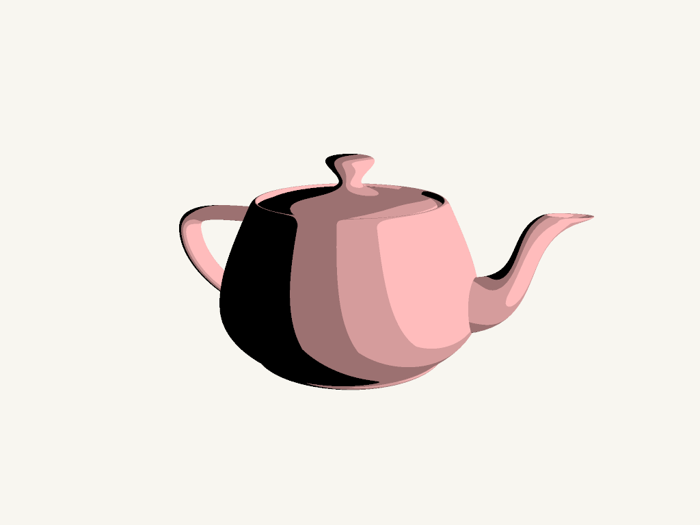
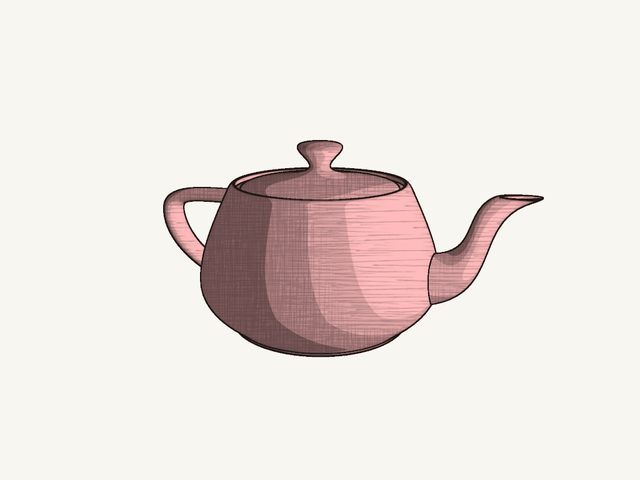
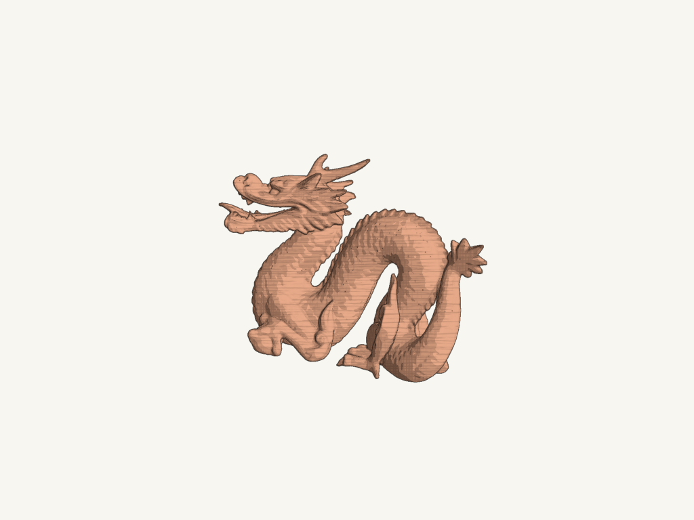

# toon-shading — cel only

Based on frozen branch1. The default shows only the original cel color bands: no outline, internal ink or hatching is composited. Run `uv run python npr_demo.py`. Other modes remain available explicitly for debugging, but are disabled by default.



The shared pipeline documentation follows; combined-mode illustrations below are reference comparisons, not this branch's default.

# HW2 + Slang cel shading / feature lines / hatching

A runnable extension of this repository's HW2.7 renderer. It combines cel bands, depth/normal feature lines (including internal creases), and the original six hatching textures from an existing GLSL implementation. Rendering runs in SlangPy; PNGs and the animation below are actual shader output.




## Run

From this repository's root, with Python 3.13 and the existing `uv` dependency setup:

```bash
uv sync
uv run python npr_demo.py
```

This opens the existing Balboa window and animates the Utah Teapot. The usual HW2 entry remains available unchanged, e.g. `uv run python main.py 2_7 scenes/hw2/dragon_spin.json`.

Headless exports:

```bash
uv run python npr_demo.py --output outputs/teapot.png
uv run python npr_demo.py --compare outputs/teapot
uv run python npr_demo.py --turntable outputs/teapot.gif --frames 48 --fps 12
```

Five styles are available: `phong`, `toon`, `lines`, `hatching`, `combined`. Use `--style lines` to see that internal features are included. The standalone toon and hatching modes preserve the source shading formulas; combined mode adds controlled composition.

Dragon is an additional demonstration using the original course asset. This preset uses thinner, less opaque lines to avoid swamping its detailed head:

```bash
uv run python npr_demo.py scenes/npr/dragon.json \
  --normal-threshold 0.07 --depth-threshold 0.03 \
  --line-width 0.5 --line-opacity 0.8 --hatch-strength 0.28
```



## Relationship to the homework

The original framework, dependencies, `main.py`, window, device/buffer utilities, and all original scenes are retained. HW2's missing exercises were completed in a separate commit. The NPR commit consists of new files only and can be applied to an already completed HW2 implementation with the same public helper interfaces (`compose_transformations`, `interpolate_transformation`, `create_Kd_texture`).

| File | Role |
| --- | --- |
| `npr_demo.py` | Separate launch/export command |
| `hw2/npr.py` | Existing scene parsing, SlangPy render pass, two MRTs, composition |
| `hw2/npr_lighting.slang` | Phong comparison, original toon/hatching formulas, combined color |
| `hw2/npr_lines.slang` | Existing normal/depth contour algorithm and supersample resolve |
| `hw2/npr_assets/` | Six original 256×256 hatch images |
| `scenes/npr/` | Independent teapot/dragon scenes; original scenes untouched |
| `third_party/npr_glsl/` | Original GLSL sources for comparison and attribution |

The official Utah Teapot is supplied in the existing JSON mesh format, with 19,992 vertices and 36,672 triangles, including source normals and UVs. No OBJ/glTF importer was added to the framework. See `THIRD_PARTY.md` for provenance. The demonstration uses a constant object color; model UVs are available for future diffuse textures. Hatching itself uses screen pixels in the upstream implementation, so it does not require model UVs.

## What was preserved, and what the integration adds

Source: `kwandrus/Non-Photorealistic-GLSL-Shaders`, commit `8d9a3f9e517ac2a670a6752d3d93393eb917b72c`. Its toon, hatching, and Gooch+outline are separate demos, not one combined shader.

Preserved:

- Toon: `max(ceil(dot(N,L)*steps)/steps, 0)` multiplied by light/object color.
- Hatching: original six images, original intensity weights (including the source's `0.2326` coefficient), integer screen-pixel wrapping with period 256, and LOD-0 texture reads. Top-left Slang pixels are converted to the source's bottom-left convention.
- Lines: the original 3×3 weighted center-difference operator, squared thresholds, and maximum of normal and depth responses. The original calls it “Sobel,” but it is not the conventional Sobel X/Y convolution. It consumes interpolated world normals and world-position Z, as the source actually writes them.
- The teapot demo uses a point light without distance attenuation. Existing homework directional lights remain supported in NPR. HW2.7's lighting is unchanged except for completing its missing implementation.

Integration changes:

- One Slang MRT pass shares exactly the same visible fragments between color and normal/depth data; a compute pass adds lines and resolves 2×2 supersampling.
- Floating-point geometry targets preserve signed normals/Z. The original OpenGL unsized RGB render targets may clamp/quantize them. Viewport-border reads are clamped. This is a formula-level port, not a claim of pixel-identical output from the original application.
- `combined` lifts the darkest cel band and the hatching input by `--shadow-lift` (default 0.24), then mixes ink by `--hatch-strength` (0.4). This prevents source black endpoints from hiding internal ink. Standalone `toon` / `hatching` retain the original formulas.
- Line width and the hatch period are measured in output pixels so changing SSAA does not double their apparent size. Ink defaults to a dark warm color; use `--ink-color 0 0 0` for source black.
- Camera framing, paper background, source replacement mesh and the combination are presentation choices, not copied original scene assets. Source `teapot3.obj` was absent from its repository.

Useful controls: `--color-steps`, `--hatch-strength`, `--hatch-scale`, `--shadow-lift`, `--line-width`, `--normal-threshold`, `--depth-threshold`, `--line-opacity`, `--ssaa`, `--time`.

## Known limits

This is a screen-space sketch renderer. It detects visible depth discontinuities and normal changes, not all artist-drawn suggestive contours or every tiny smooth-surface feature. It does not implement path-space line transport, cast shadows, curvature-aligned strokes, or temporal reprojection. Hatch strokes stay in screen space as the model rotates, as in the source. Small mesh features and cel thresholds can change across frames; SSAA reduces spatial aliasing but does not guarantee temporal stability. Fixed world-Z and normal thresholds are scene/scale dependent.

Validation used real Slang shaders on Mesa's software Vulkan device, not a physical GPU. macOS Metal, the interactive GUI, and hardware performance still need a run on the user's machine. See `VALIDATION.md`.
